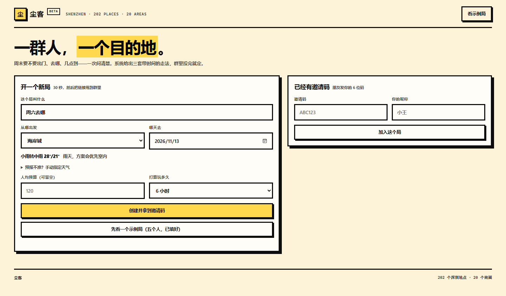
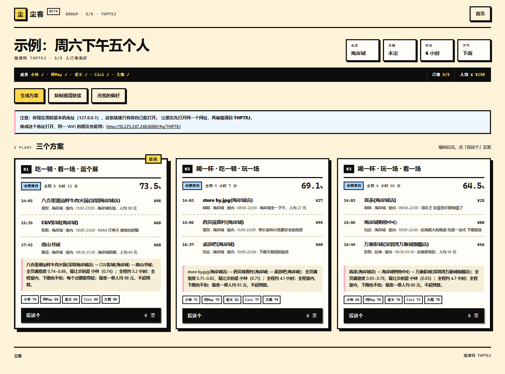

# 尘客 · 一群人去哪玩

<p>
  <a href="https://github.com/Chenk44/chenke/actions/workflows/ci.yml"></a>
  
  
  
  
</p>

> 同是尘客，同走一程。

**给一群人（而不是一个人）推荐去哪玩。** 建个局，把链接甩到群里，每个人各填各的口味，
系统输出 3 个「地点组合 + 动线」方案，每个方案都告诉你：大家的共识度多少、谁让步最多，
最后群里投票定案。

一个人做推荐，是"我喜欢什么"；一群人做决策，是"我们能接受什么"。
这中间的差别，就是这个项目存在的理由。



<details>
<summary>点开看方案的完整样子（真实运行截图：桌面端三个方案并排，示例局 5 个人、下雨天）</summary>



*桌面端横向铺满、三个方案一屏比完；手机上自动退成单列，卡片顺序不变。*

</details>

---

## 一、它解决的到底是什么问题

周五晚上，五个人的群：

> A：周末去哪？
> B：都行。
> C：别太远。
> D：别太贵。
> E：上次那家又不好吃。
> ……（四十分钟后）
> A：那还是去楼下商场吧。

这不是"找不到好地方"的问题。**是"五个人的偏好没法合成一个决定"的问题。**
点评、小红书、高德都能回答"哪里好"，但没有一个产品回答"**我们**去哪好"。

「尘客」只做这一件事，所以它能做得很深：

| 现有产品 | 回答的问题 | 输出 |
| --- | --- | --- |
| 大众点评 | 这个地方好不好 | 一个地点的评分 |
| 小红书 | 别人去哪玩了 | 一堆笔记 |
| 高德 | 怎么过去 | 一条路线 |
| **尘客** | **我们这群人去哪好** | **一组可执行的方案 + 谁让步了** |

## 二、30 秒看懂它怎么用

1. **建局**：起个名、选出发商圈、**选日期**（系统自己去查那天的天气，下雨就自动优先室内）、填人均预算 → 拿到 6 位邀请码。
2. **各填各的**：三个滑杆（安静↔热闹 / 省钱↔舍得 / 近↔远）+ 硬条件（想待室内 / 想出去走走、带娃、开车、忌口）
   + 一句话（"想吃火锅，晚上七点出发，最多三小时"——系统把它拆成 16 个结构化约束，
   连"想吃火锅"这种正向愿望和"不要玩桌游"这种排除都会进排序）。
3. **出方案**：点一下，得到 3 个方案，每个是 2~3 个地点连成的动线，带时刻表，例如
   `14:18 %Arabica 咖啡 → 15:20 诚品生活 → 16:52 迷之密室`，
   附一句人话解释和每个人的满意度。
4. **投票定案**：每个人投一票，票数最高的方案标记出来。

不想先编五个人的口味？打开页面点「**先看一个示例局**」（或直接访问 `/#demo`），
五秒钟看到产品最终形态——示例局里的五个人是真的口味冲突：要安静的、要热闹的、
带娃的、海鲜过敏的、开车的。

## 三、为什么不只是"加了个滤镜的推荐系统"

三条都是可验证、可答辩的技术点，不是文案：

**1）共识分：把"公平"变成可计算的数**

```
共识分 = 0.6 × 平均满意度 + 0.4 × 最低满意度
```

两个方案平均分都是 0.63，但一个让某个人只有 0.1 分，另一个人人 0.6 分以上——
前者看起来"还行"，实际上是有人被牺牲了。「尘客」会选后者，并且**明确告诉你是谁让步了**。
这是"一个人的推荐"和"一群人的决策"的分界线。

**2）两条独立的聚合规则交叉验证**

除了共识分，还同时算 Borda 计数（只看相对名次，抵抗"某人打分特别宽松"）
和 minimax regret（最小化最坏情况下的后悔）。三条路径的排序一致度高，说明结论稳，
不是调参调出来的；不一致度高，就提示"这组偏好分歧明显，建议投票"。

**3）枚举 2~3 个地点的组合与顺序，而不是只排单个地点**

先在共识分 Top24 的池子里枚举，`C(24,3)=2024` 种组合 × 最多 6 种顺序 ≈ 1.2 万种，
全部算一遍在毫秒级完成。**这个规模下穷举是全局最优的**，上遗传算法反而引入调参风险和不可复现性。
方案之间还做了 Jaccard 去重，保证三个方案真的不一样。

> 答辩时如果被问"为什么不用更高级的算法"：因为在这个问题规模上，聪明的算法不如把问题定义对。
> 我们花时间的地方是"公平怎么定义""距离该用步行还是地铁""没填偏好的人怎么处理"。

## 四、快速开始

### 需要

- Python 3.10+（开发和测试用的是 3.12）
- 不需要数据库服务：默认 SQLite，跑起来就是一个文件

### 三步启动

```bash
# 1. 装依赖（建议虚拟环境）
python -m venv .venv
# Windows: .venv\Scripts\activate    macOS/Linux: source .venv/bin/activate
pip install -r requirements.txt

# 2. 把深圳地点表灌进数据库
python -m scripts.seed

# 3. 启动
python -m uvicorn app.main:app --app-dir backend --reload
```

打开 <http://127.0.0.1:8000> 就是产品页面，<http://127.0.0.1:8000/docs> 是自动生成的接口文档。
点页面上的「先看一个示例局」，五秒钟就能看到完整效果——不用先编五个人的口味。

不想开浏览器？命令行走一遍同样的流程，直接把方案打在终端里：

```bash
python -m scripts.demo
```

Windows 用户也可以直接双击/运行仓库根目录的 `run.ps1`，它会把上面三步做完。

### 跑测试

```bash
python -m pytest -q
```

125 个测试，覆盖效用函数、聚合规则、组合搜索、一句话解析、营业时间、通行时间表、天气回填，以及全部 API 端点。
每个测试都对应文档里的一句话，改坏了 CI 会红。

## 五、项目结构

四层：**纯算法包 → Web 壳 → 一张数据表 → 单页前端**。分层的唯一目的是——
让算法能脱离框架单独测试。下面的行数是按文件逐行数出来的（含空行与 `__init__.py`），改完代码记得回头对一遍。

```
.
├── algo/                      1 319 行  纯 Python，不 import 任何 Web / ORM 库
│   ├── types.py                 136     POI / Preference / Plan；含「几点还开着」的判定
│   ├── geo.py                    62     球面距离 + 通行时间估算（地铁/驾车两套参数）
│   ├── travel.py                 74     商圈通行表：查得到用真实路网，查不到退回估算
│   ├── utility.py               204     单人效用 U(地点, 偏好)：滑杆 + 品类/标签/排除
│   ├── aggregate.py             145     共识分、Borda 计数、minimax regret、排序一致度
│   ├── combine.py               296     组合与动线搜索、打烊降权、多样性去重、人话解释
│   ├── pipeline.py              196     把上面几步编排成一次 run()
│   └── loader.py                178     读 CSV 并逐列校验（脏数据启动即报错）
├── backend/app/               2 068 行  Web 层，只做三件事：校验、读写库、转格式
│   ├── main.py                  117     FastAPI 入口、CORS、静态挂载、422 文案、/api/netinfo
│   ├── config.py                 39     pydantic-settings 读 .env
│   ├── db.py                    124     引擎、建表、老库补列与布尔列迁移
│   ├── models.py                179     7 张表：局/成员/偏好/地点/方案/投票/评价
│   ├── schemas.py               223     请求响应模型（OpenAPI 文档就是它生成的）
│   ├── routers/groups.py        351     建局（按日期回填天气）、加入、填偏好、示例局
│   ├── routers/plans.py         149     生成方案、拉方案、投票、计票
│   ├── routers/pois.py           83     地点列表、商圈列表、地点评价
│   ├── routers/weather.py        51     按日期查天气（7 天内）
│   ├── services/nlp.py          389     一句话 → 结构化约束（规则版，3 毫秒，可测）
│   ├── services/weather.py      246     高德 + Open-Meteo 两级预报，翻成四种天气
│   └── services/recommender.py  112     ORM ↔ algo 的唯一翻译层
├── data/pois_shenzhen.csv      35 KB     202 个深圳地点 × 20 列（本项目最核心的资产）
├── data/pois_draft.csv         27 KB     脚本先猜的草稿标注（157 条，人工复核的底稿）
├── data/amap_shortlist.csv    141 KB     高德候选去重后的短名单（647 条，draft_labels 的输入）
├── data/area_travel.csv        11 KB     20 个商圈两两的驾车/公交分钟数（高德路网预计算）
├── web/index.html             1 065 行  单页前端，零构建、零依赖；桌面三栏、手机单列
├── tests/                     1 291 行  125 个用例：算法、聚合、组合、接口、解析、营业时间、通行时间、天气
│   ├── conftest.py               39     先设 DATABASE_URL 再 import app（顺序很关键）
│   ├── test_algo.py             459     效用、聚合、组合、时间线、加载器校验、全员排除
│   ├── test_api.py              316     全部接口的端到端行为
│   ├── test_nlp.py              148     一句话解析的边界（含否定与条件句）
│   ├── test_hours.py            154     高德时间串解析、跨零点、打烊降权
│   └── test_travel.py            55     商圈通行表查询与「查不到就估算」的兜底
├── scripts/                   1 704 行
│   ├── seed.py                   94     CSV → 数据库，可重复执行（--reset 清空重来）
│   ├── demo.py                  175     命令行端到端演示：不开浏览器也能看到算法在干什么
│   ├── fetch_amap.py            256     高德 POI 拉取（缓存、重试、直连兜底）
│   ├── shortlist.py             161     候选短名单：品牌去重 + 每商圈每品类限额
│   ├── draft_labels.py          371     草稿标注：把高德拿不到的 9 个字段先猜一版
│   ├── merge_pois.py             70     人工表 + 草稿表合并（同名同地点去重）
│   ├── open_hours.py            103     营业时间：解析高德时间串、按品类兜底
│   ├── backfill_hours.py        101     把营业时间回填进 CSV（149 条来自高德）
│   ├── fetch_travel.py          154     商圈两两通行时间预计算（380 次请求落成一张表）
│   ├── audit_pois.py           116     数据体检：把可疑标注挑出来，人只复核这几行
│   └── layout_probe.py          102     移动端布局体检（CDP 量宽度、找越界元素）
├── docs/
│   ├── ALGORITHM.md             468     算法说明书：从痛点推到公式
│   ├── API.md                   350     17 个接口 + 真实响应样例
│   ├── DATA.md                  139     数据来源、标注口径、合规说明
│   ├── evidence.html                   答辩证据页：一页看完所有数字 + 复现命令（离线单文件）
│   └── preview-*.png                    README 用的两张真实截图
├── .github/workflows/ci.yml      44     push 即跑：ruff → 灌数据 → 125 测试 → 真起服务 curl
├── run.ps1 / run.sh                     一键启动（Windows / macOS+Linux）
├── Dockerfile                    32     多阶段构建 + 非 root 用户
└── requirements.txt / pyproject.toml    依赖 7 个；pytest 与 ruff 配置
```

**一次「生成方案」怎么穿过这些文件**——这是理解整个项目最快的方式：

```
web/index.html          点「生成方案」
  → routers/plans.py            读局、读成员、读偏好
  → services/recommender.py     POIRecord→POI，PreferenceRecord→Preference
  → algo/pipeline.py            recommend()
        ├── utility.py          每人给每个地点打分
        ├── aggregate.py        合成共识分 + Borda + minimax regret
        ├── geo.py              算地点间通行时间
        └── combine.py          枚举组合与顺序，选出 3 个方案
  → models.py                   写进 PlanRecord（JSON 快照，投票要引用它）
  → web/index.html              渲染成带时间线的方案卡
```

三个刻意的分层决定，答辩时可以直接讲：

1. **`algo/` 不 import FastAPI，也不 import SQLAlchemy**。1 319 行算法被 69 个算法与解析测试直接覆盖，
   跑测试不需要起服务、不需要连着数据库、不需要网络。算法是这个项目的价值，它必须能单独被验证。
2. **`services/recommender.py` 是唯一同时认识两边的文件**。它导出 `record_to_poi` /
   `member_to_preference` / `run_recommendation` 三个函数；`algo` 反向完全不认识数据库。
   想换存储（比如从 SQLite 换到 Postgres），只改这一个文件。
3. **`web/index.html` 是单文件、零构建**。评委 clone 下来不用 `npm install` 就有完整界面，
   代价是可维护性——这个取舍在 10 天工期下是划算的，写在 `docs/ALGORITHM.md` 的取舍一节。

> 答辩时如果想直接投屏：打开 `docs/evidence.html`（离线单文件，含所有关键数字与复现命令），
> 也可以用它「打印 → 另存为 PDF」当材料交。

## 六、数据从哪来（合规性说明）

- **结构化字段来自高德开放平台 POI 检索**（名称、坐标、品类、人均、评分），
  属于官方开放接口的正常使用，不爬取、不绕过任何反爬措施。
- **剩下 9 个字段是人工标注的**：室内/室外、安静度（0~1）、适合人数的上下限、
  是否适合带娃、是否需预约、排队程度（0~1）、标签、一句话推荐理由。
  这部分是评委问"你的数据凭什么比点评好"时的答案：
  点评的标签是给"陌生人"看的，我们标的是"一群人决策需要知道的东西"——
  比如"这家 6 人起订"「下午三点后要排队 40 分钟」「展厅里说话要小声」。
- 完整字段说明见 [docs/DATA.md](docs/DATA.md)。

> 我们**没有**爬大众点评或小红书。理由写在 docs/DATA.md 里：
> 合规风险不可控、反爬策略一周一变、以及最关键的——陌生人的评分对"我们这群人"的解释力，
> 本来就不如"我们自己人玩完之后的评价"。所以产品里做了事后评价功能，
> 让这个局的数据在玩完之后沉淀下来。

## 七、主要接口

| 方法 | 路径 | 说明 |
| --- | --- | --- |
| POST | `/api/demo` | 一键生成填好的示例局（5 个人，进来就能看结果） |
| POST | `/api/groups` | 建局，返回 6 位邀请码 |
| GET | `/api/groups/{code}` | 局的信息 + 成员列表 |
| POST | `/api/groups/{code}/members` | 用昵称入局（重名幂等） |
| PUT | `/api/members/{id}/preference` | 填/改偏好，可带一句话自动解析 |
| GET | `/api/members/{id}/preference` | 读偏好 |
| POST | `/api/parse` | 只解析一句话、不保存（前端实时提示） |
| POST | `/api/groups/{code}/recommend` | 生成 3 个方案 |
| GET | `/api/groups/{code}/plans` | 读取上次生成的方案 |
| POST | `/api/plans/{id}/vote` | 投票（幂等） |
| GET | `/api/groups/{code}/votes` | 票数统计 |
| GET | `/api/pois` | 地点列表，支持商圈/品类/室内过滤 |
| GET | `/api/areas` | 商圈列表 |
| POST | `/api/reviews` | 玩完之后的评价 |
| GET | `/api/pois/{id}/reviews` | 某个地点的评价 |
| GET | `/api/health` | 健康检查（容器探针 / CI 用） |
| GET | `/api/weather?date=YYYY-MM-DD` | 查那天的天气（7 天内；查不到会说查不到，不报错） |

完整定义见 `/docs`（OpenAPI），或 [docs/API.md](docs/API.md)。

## 七点五、技术文档

比赛用的技术报告在这里（16 页 A4，PDF）：

- [尘客技术文档.pdf](docs/尘客技术文档.pdf) — 意图控制策略（怎么设计上下文与提示词）、
  架构设计与约束方式、可复现性论证，附录给出了需求原话与本文每个数字的核对命令。
- 源文件是 [docs/tech-report.html](docs/tech-report.html)，改完用 Edge 无头打印即可重新导出：
  `msedge --headless=new --no-pdf-header-footer --print-to-pdf=docs/尘客技术文档.pdf file:///D:/bisai/docs/tech-report.html`

## 八、部署

```bash
docker build -t chenke .
docker run -p 8000:8000 chenke
```

生产环境把 `DATABASE_URL` 换成 PostgreSQL 即可，代码里没有 SQLite 专有语句。
其余配置见 `.env.example`。

### 同一 WiFi 下给朋友填

服务监听 `0.0.0.0`，同一局域网的人可以直接访问你电脑的局域网地址
（启动时 `run.ps1` 会把它打印出来，页面上也会提示换成本机 IP 的链接）。
这个场景不需要任何额外配置，也没有额外暴露面。

## 九、已知局限

这一节不是免责声明，是**取舍清单**：哪些是刻意不做的，哪些是做了但没做到底的，都有具体数字。

1. **只做了深圳。** 换城市要重跑 `fetch_amap` → `shortlist` → `draft_labels` → `backfill_hours`，
   再人工复核 2 天。这是刻意的：十个城市各 20 条，不如一个城市 202 条标得准。
2. **通行时间是「预计算 + 估算」的组合，不是实时路况。**
   20 个商圈的两两时间已经用高德路径规划拉下来了（`data/area_travel.csv`，190 对 ×
   驾车/公交 = 380 行，双向各一行，跟着仓库走，断网也能用）；
   表里查不到的（同商圈内部、将来新加的商圈）才退回球面距离估算，误差 20% 左右——
   最离谱的例子是「海岸城 → 龙华」，估算 40 分钟，实际公交 83 分钟。
   不在运行时直接调 API，是因为一次推荐要算 24² 量级的两两时间，免费配额会被枚举打光。
3. **营业时间只到「这个点去还开不开」，不到「今天开不开」。**
   202 个地点里 149 条的营业时间直接来自高德，其余 53 条按品类和名字兜底
   （公园全天、美术馆 10-22、夜宵摊到凌晨 2 点）。到了打烊时间只降权 0.25 并标红，
   不硬删——因为把出发时间提前半小时可能就又能去了。
   节假日、临时闭馆、需要预约的场次都还没建模。
4. **一句话解析是规则版，不是大模型。** 这是刻意的：规则可测、3 毫秒返回、断网可用、
   失败模式是「漏识别」而不是「胡说八道」。接大模型的正确做法是让它输出同样的结构化约束，
   规则版本做兜底，而不是让它直接决定推荐结果。
5. **文字约束是「软」的，只有全组一致时才变硬。** 一个人说「想吃火锅」只在效用分里加 0.07，
   说「不要桌游」只乘 0.2 的惩罚；但**五个人都说不要的品类会被直接从候选里删掉**，
   并在方案上方明说「已去掉 N 个地点」。硬过滤一个人说了算，容易一次误判把好地点全毙掉；
   代价是「我说了想吃火锅」偶尔仍会混进别的类型。
6. **202 条里有一半是「脚本先猜、人工复核」出来的。** 名字/坐标/评分/人均/营业时间来自高德，
   室内外、安静度、适合人数这些是标出来的。为了不让错误烂在库里，写了
   `python -m scripts.audit_pois` 做交叉体检（公园标成室内、餐饮人均 0、只开 2 小时、
   同名同坐标），现在报 0 处可疑；发现错标就在 `data/pois_shenzhen.csv` 改一行、
   重跑 `python -m scripts.seed`，不用改代码。

7. **天气是城市级的 7 天预报，不是「你要去的那个商圈此刻下雨」。**
   高德给今天 + 未来 3 天（中文天气词，和 POI 数据同源），Open-Meteo 补到 7 天
   （WMO 代码 + 降水概率，不需要 key），两级并成一张「日期 → 天气」表并缓存半小时；
   两个源都挂了就退回手动选天气，**建局不会失败**。超出 7 天会明说「只能预知 7 天」，
   而不是瞎猜一个。天气只修正「没表态的人」的室内外倾向，自己说了「想出去」的照样尊重。

## 十、许可

MIT，见 [LICENSE](LICENSE)。
